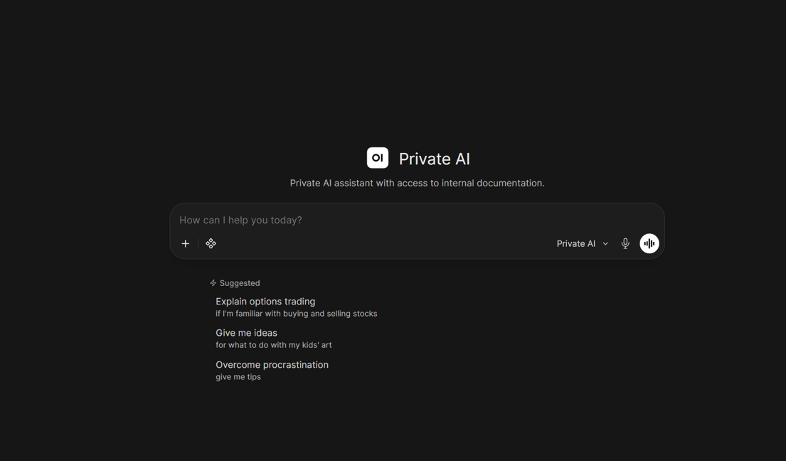

# Azure Private AI: app and CI/CD

A chat assistant that answers from your own documents. It runs on an Azure VM with no public IP.
GitHub Actions builds the images on pull requests and deploys them on merge.



Infrastructure: [terraform-azure-private-ai](https://github.com/adrian-olias/terraform-azure-private-ai)

## First deploy to Dev

1. Apply the infrastructure first, following its README.

2. Add these repository variables under Settings → Secrets and variables → Actions → Variables:

   - `AZURE_CLIENT_ID`, `AZURE_TENANT_ID`, `AZURE_SUBSCRIPTION_ID`: from the `github_oidc` output
   - `ACR_NAME`: from `container_registry_names`

3. Create an environment named `Dev` with these variables:

   - `RESOURCE_GROUP`: `rg-privateai-lab`
   - `VM_NAME`: `vm-privateai-lab`
   - `KEY_VAULT_NAME`: `kv-privateai-lab-<suffix>`
   - `AZURE_STORAGE_ACCOUNT`: `stprivateailab<suffix>`
   - `WEBUI_ADMIN_EMAIL`: the admin login for the chat
   - `WEBUI_ADMIN_NAME`: the admin's display name (e.g. `Admin`)
   - `WEBUI_NAME`: the name shown in the chat (e.g. `Private AI`)
   - `CUSTOM_MODEL_NAME`: the name of the custom model (e.g. `Private AI`)
   - `CUSTOM_MODEL_ID`: optional. The model's ID (default `private-ai`)
   - `SYSTEM_PROMPT`: optional. The model's system prompt. Leave empty for the built-in one. It must be a single line
   - `KNOWLEDGE_BASE_NAME`: the name of the knowledge base (e.g. `Company Documents`)
   - `AZURE_DOCS_CONTAINER`: the storage container with the documents (`documents`)
   - `SYNC_INTERVAL_MINUTES`: how often the documents are synced (`15`)
   - `BASE_MODEL`: the base model to pull (`llama3.2:3b`)
   - `OLLAMA_MODELS`: the models Ollama pulls, comma-separated (`llama3.2:3b`)
   - `OLLAMA_VERSION`: the Ollama image tag (`0.40.6`)
   - `OPEN_WEBUI_VERSION`: the Open WebUI image tag (`v0.12.4`)
   - `OPEN_WEBUI_PORT`: the local port of the chat on the VM (`3000`)
   - `DEFAULT_LOCALE`: the chat's language (`en-US`)
   - `ENABLE_SIGNUP`: whether users can sign up. Keep `false`, the admin is created by the bootstrap (`false`)
   - `ENABLE_WEB_SEARCH`: whether the chat can search the web. Keep `false` for private data (`false`)
   - `RAG_EMBEDDING_MODEL`: the embedding model for the knowledge base (`sentence-transformers/all-MiniLM-L6-v2`)

   The values in parentheses are the current defaults. The workflow uses them while a variable is not set. The Key Vault and storage names are printed at the end of `terraform apply`.

4. In the Azure portal, open the Key Vault and create two secrets:

   - `webui-secret-key`: a long random string
   - `webui-admin-password`: the admin password

5. Upload your documents to the `documents` container of the storage account. They reach the assistant within 15 minutes.

6. Create the `dev` branch from `main`:

   ```bash
   git push origin main:dev
   ```

7. Open a pull request from `feature/<name>` to `dev` and merge it. The deploy runs on merge, and the model's answer appears in the run summary.

## Production

Create a `Production` environment with the same variables, pointing at its own VM. Add a required reviewer, so a merge from `dev` to `main` waits for approval.

## Layout

```
.github/workflows/build_and_push.yml   build on pull request, deploy on merge
services/docs-sync/                    syncs the Storage container into the knowledge base
services/webui-bootstrap/              creates the admin, knowledge base and custom model
docker-compose.yml                     the stack
```
