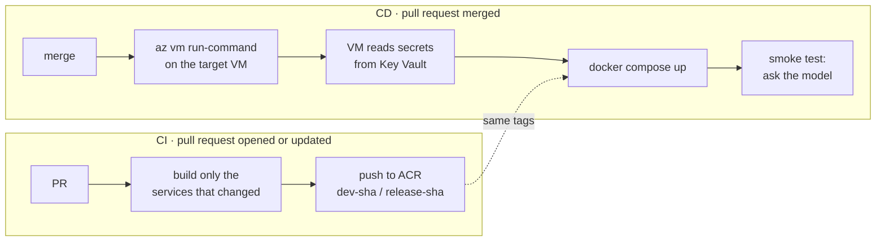

# Azure Private AI — app and CI/CD

[](https://github.com/adrian-olias/azure-private-ai-cicd/actions/workflows/build_and_push.yml)

A private AI assistant that answers from your own documents, deployed by GitHub Actions to a VM
with no public IP. The infrastructure is in
[`terraform-azure-private-ai`](https://github.com/adrian-olias/terraform-azure-private-ai).

No stored credentials anywhere: GitHub Actions logs in to Azure with **OIDC**, the VM uses its
**managed identity** for the registry, Key Vault and Storage, and the secrets live in **Key Vault**.

## Pipeline



| Branches | CI builds | Merge deploys to |
|---|---|---|
| `feature/*` → `dev` | `dev-<sha>` | `Dev` environment |
| `dev` → `main` | `release-<sha>` | `Production` environment |

Any other branch pair does nothing. Every job runs on GitHub-hosted runners:

| Job | What it does |
|---|---|
| `build-and-push` | Picks the environment from the branches and logs in with OIDC. Tags each service with the last commit that changed its folder, then builds and pushes only the tags that are not in ACR yet |
| `deploy` | On merge only. OIDC login, then `az vm run-command` runs the deploy script on the VM: managed identity login, secrets from Key Vault into a `.env`, `docker compose up`, a question to the model, `.env` deleted. The answer is shown in the run summary |

Design choices:

- **Only what changed is built.** A PR that touches one service builds one image; the others keep their tag.
- **Build in the PR, deploy on merge.** The merge deploys the tags CI pushed while the PR was open.
- **Deploy with no network path to the VM.** `run-command` goes through Azure's control plane: no SSH, no open port, no agent to register.
- **Secrets never reach GitHub.** The VM reads them from Key Vault through its private endpoint.
- **Environments are configuration.** Each GitHub environment names its VM, Key Vault and Storage. `Production` has a required reviewer, so a merge to `main` waits for approval.

## The stack

| Service | Image | Role |
|---|---|---|
| `ollama` | `ollama/ollama` | Model server, on CPU: a 3B model answers in a few seconds |
| `ollama-puller` | `ollama/ollama` | One-off job: downloads the models on a fresh disk |
| `open-webui` | `ghcr.io/open-webui/open-webui` | Chat UI and API, with its built-in vector store and RAG. Listens on the VM's localhost only |
| `webui-bootstrap` | **built in CI** | One-off job: admin account, knowledge base and a custom model linked to it |
| `docs-sync` | **built in CI** | Every 15 min: Azure Blob Storage → knowledge base, with the VM's managed identity |

Upload a PDF to the `documents` container and within one sync interval the assistant can answer
from it. Delete it and it is removed from the knowledge base. Public images are pinned to exact
versions.

## Setup

After the infrastructure is applied (see its README):

1. **Repository variables** (Settings → Secrets and variables → Actions → Variables): `AZURE_CLIENT_ID`, `AZURE_TENANT_ID` and `AZURE_SUBSCRIPTION_ID` from the `github_oidc` output, and `ACR_NAME` from `container_registry_names`.

2. **Environments** `Dev` and `Production`, each with these variables (no secrets):

   | Variable | Value |
   |---|---|
   | `RESOURCE_GROUP`, `VM_NAME`, `KEY_VAULT_NAME`, `AZURE_STORAGE_ACCOUNT` | the names printed by `terraform apply`, or shown in the portal |
   | `WEBUI_ADMIN_EMAIL` | admin login for the chat |
   | optional | `WEBUI_NAME`, `CUSTOM_MODEL_ID`, `CUSTOM_MODEL_NAME`, `KNOWLEDGE_BASE_NAME`, `BASE_MODEL`, `OLLAMA_MODELS`, `SYNC_INTERVAL_MINUTES` |

   Add yourself as a required reviewer on `Production`.

3. **Secrets and documents**: the two secrets and the `documents` container are set in the portal, as described in the infrastructure README.

Then open a PR from `feature/*` to `dev`, and merge it. The run summary shows the model's answer.

## Try it

In the portal: Virtual machines → your VM → Run command → RunShellScript, and run:

```bash
docker exec privateai-dev-ollama-1 ollama run llama3.2:3b 'What is a private endpoint?'
```

## Repository

```
.github/workflows/build_and_push.yml   build-and-push (changed services) -> deploy (run-command)
services/
  docs-sync/                           Blob Storage -> knowledge base
  webui-bootstrap/                     admin, knowledge base, custom model
docker-compose.yml                     the stack
.env.example                           what the deploy script writes on the VM
```

## License

MIT
